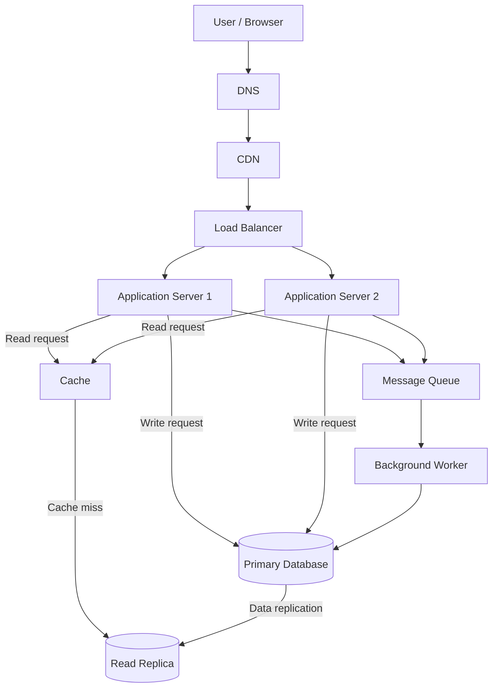
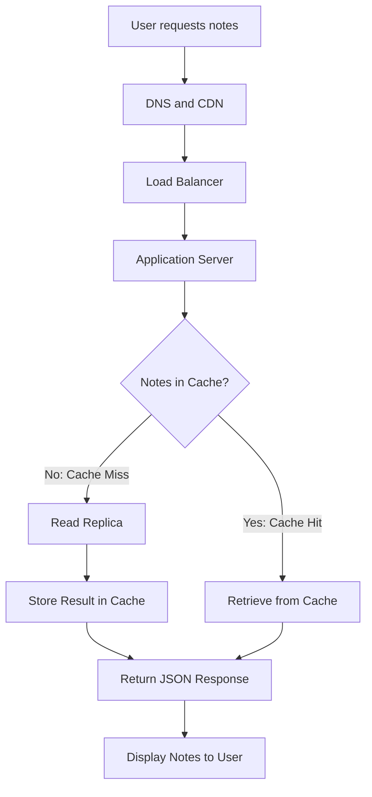
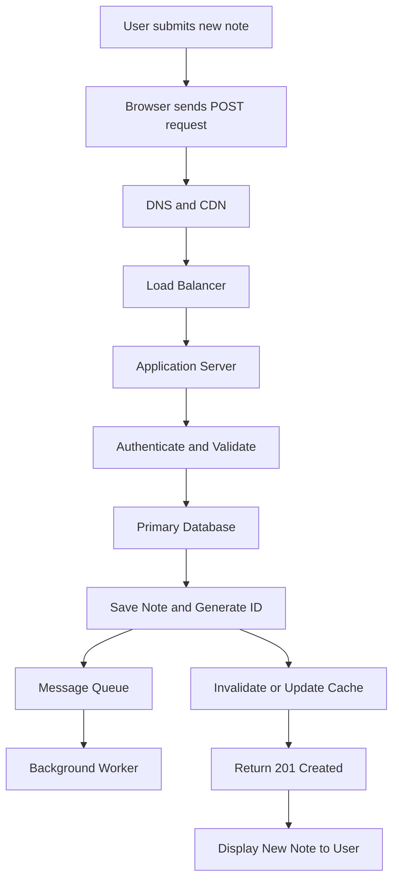

# QuickNotes System Architecture

## 1. System Requirements

### A. Functional Requirements

Functional requirements describe what the QuickNotes system must do.

1. Users must be able to register and log in securely.
2. Users must be able to create notes with a title and body.
3. Users must be able to view a list of their notes.
4. Users must be able to view an individual note.
5. Users must be able to update existing notes.
6. Users must be able to delete their notes.
7. Users must be able to organise notes using tags.
8. Users must only access notes that belong to their accounts.

### B. Non-Functional Requirements

Non-functional requirements describe how well the system must operate.

1. **Scalability:** The system must support growth towards one million registered users without major architectural changes.

2. **Performance:** The system should respond to common note retrieval requests within two seconds under normal operating conditions.

3. **Availability:** The system should remain accessible even when an individual application server or infrastructure component fails.

4. **Security:** User passwords must be securely hashed, communication must use HTTPS, and access to notes must be restricted to authenticated users.

5. **Reliability:** The system must protect user data through database backups and replication.

6. **Maintainability:** The system should use modular components that can be updated and maintained independently.


## 2. Capacity Estimates for One Million Users

The following estimates use one million registered users. The calculations assume that only 10% of registered users are active daily.

### A. Planning Assumptions

| Measure | Assumption |
|---|---:|
| Registered users | 1,000,000 |
| Daily active users | 100,000 (10%) |
| Reads per active user per day | 20 |
| Writes per active user per day | 2 |
| Average size of a new note | 1 KB |
| Days per year | 365 |

### B. Estimated Reads Per Second

Daily reads:

100,000 active users × 20 reads = 2,000,000 reads per day.

Reads per second:

2,000,000 ÷ 86,400 seconds = approximately 23 reads per second.

### C. Estimated Writes Per Second

Daily writes:

100,000 active users × 2 writes = 200,000 writes per day.

Writes per second:

200,000 ÷ 86,400 seconds = approximately 2.3 writes per second.

### D. Estimated Annual Storage

Annual storage:

100,000 active users × 2 notes × 365 days × 1 KB = 73,000,000 KB.

This is approximately 73 GB of new note data per year, using decimal storage units.

This estimate excludes database indexes, backups, metadata, and replication overhead.

### E. Capacity Summary

| Metric | Average Estimate | Peak Planning Estimate |
|---|---:|---:|
| Reads per second | 23 | 116 |
| Writes per second | 2.3 | 12 |
| New storage per year | 73 GB | 73 GB baseline |

Peak estimates use a five-times multiplier on average request traffic. Annual storage represents the estimated data generated under the stated daily usage assumptions.

These estimates provide a starting point for infrastructure planning. Actual requirements should be adjusted using system monitoring and real user activity data.


## 3. System Architecture Diagram

The following diagram illustrates the proposed architecture for QuickNotes.



The diagram shows how requests are distributed across multiple application servers. Read requests can use the cache and read replica, while write requests are handled by the primary database. Background tasks are processed through a message queue and worker.
```

## 4. Explanation of Architecture Components

| Component | Responsibility |
|---|---|
| Client (Browser) | Provides the interface through which users create, view, update, and delete notes. |
| DNS (Domain Name System) | Translates the QuickNotes domain name into the IP address of the service. |
| CDN (Content Delivery Network) | Delivers static files such as CSS, JavaScript, and images from locations closer to users. |
| Load Balancer | Distributes incoming requests across multiple application servers to prevent one server from becoming overloaded. |
| Application Servers | Process API requests, validate user input, enforce authentication, and communicate with the database and other services. |
| Cache | Temporarily stores frequently requested data to reduce repeated database queries and improve response times. |
| Primary Database | Stores the main application data and handles operations that create, update, or delete records. |
| Read Replica | Maintains a replicated copy of the primary database and handles read queries to reduce the workload on the primary database. |
| Message Queue | Holds background tasks until they are ready to be processed by a worker. |
| Background Worker | Processes queued tasks independently of the user's immediate request, such as sending notifications or performing scheduled operations. |

Each component has a specific responsibility, allowing the system to distribute work and scale different parts independently.


## 5. Request Flows

### A. GET /notes — Retrieving Notes

When a user opens QuickNotes and requests their notes, the following process takes place:

1. The user opens QuickNotes in their browser and requests their notes.
2. DNS resolves the QuickNotes domain name.
3. The CDN delivers cached static content where available.
4. The load balancer forwards the API request to an available application server.
5. The application server authenticates the user and checks whether the requested notes are available in the cache.
6. If the notes are in the cache (cache hit), the application server retrieves them directly.
7. If the notes are not in the cache (cache miss), the application server retrieves them from the read replica.
8. The retrieved notes are stored in the cache for future requests.
9. The application server returns the notes to the browser as a JSON response with HTTP status 200 OK.

**GET Request Flow:**



### B. POST /notes — Creating a Note

When a user creates a new note, the following process takes place:

1. The user enters a note title and body and submits the form.
2. The browser sends a POST request containing the note data in JSON format.
3. DNS resolves the QuickNotes domain, and the CDN handles any applicable static content.
4. The load balancer forwards the API request to an available application server.
5. The application server authenticates the user and validates the submitted note.
6. The application server sends the new note to the primary database.
7. The primary database saves the note and generates a unique ID.
8. The application server invalidates or updates the relevant cached notes so that future requests do not return stale data.
9. Any additional background tasks are placed in the message queue for the background worker to process.
10. The application server returns the newly created note to the browser with HTTP status 201 Created.

**POST Request Flow:**



The primary database handles the creation of new notes, while the cache is updated or invalidated to prevent users from receiving outdated information. Background tasks are processed separately through the message queue.


## 6. Architectural Trade-offs and Fault Tolerance

### A. Architectural Trade-offs

**1. Caching vs Data Consistency**

Caching improves performance by reducing repeated database queries. However, cached information can become outdated when a user creates, updates, or deletes a note.

QuickNotes will invalidate or update the relevant cache entries after successful write operations. This reduces the risk of displaying stale information, although cache management introduces additional complexity.

**2. Read Replicas vs Data Consistency**

Read replicas reduce the workload on the primary database by handling retrieval requests. However, replication may take a short time, meaning the replica might not immediately reflect the latest changes.

QuickNotes will use the primary database when a user needs to retrieve the latest information immediately after creating or updating a note.

**3. Background Processing vs Immediate Results**

Message queues allow time-consuming tasks to run independently without delaying the user's request. However, background tasks may not be completed immediately.

QuickNotes will use background workers for tasks such as notifications and scheduled processing, while essential operations such as saving a note will be completed before responding to the user.

### B. Avoiding Single Points of Failure

QuickNotes will use the following measures to improve system availability and reliability:

1. **Redundant application servers:** Deploy at least two application servers across separate availability zones so that the system can continue operating if one server fails.

2. **Load balancer redundancy:** Use a highly available load balancing service with health checks to detect failed application servers and redirect requests to healthy servers.

3. **Database failover:** Maintain a standby database that can take over if the primary database fails. Continue using database replication and regular backups to protect stored information.

4. **Replicated message queue:** Use a highly available queue service so that queued background tasks are not lost when an individual queue component fails.

5. **CDN and DNS availability:** Use reliable managed CDN and DNS services to reduce dependence on a single infrastructure component.

6. **Monitoring and recovery:** Monitor application servers, databases, queues, and network performance. Use alerts and automated recovery procedures to identify and respond to failures.

These measures reduce the risk that the failure of one component will make the entire QuickNotes application unavailable.

